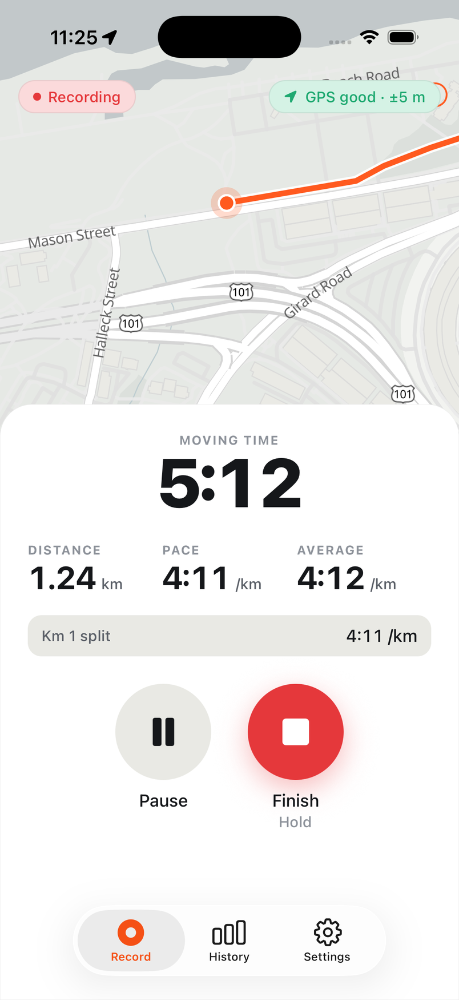
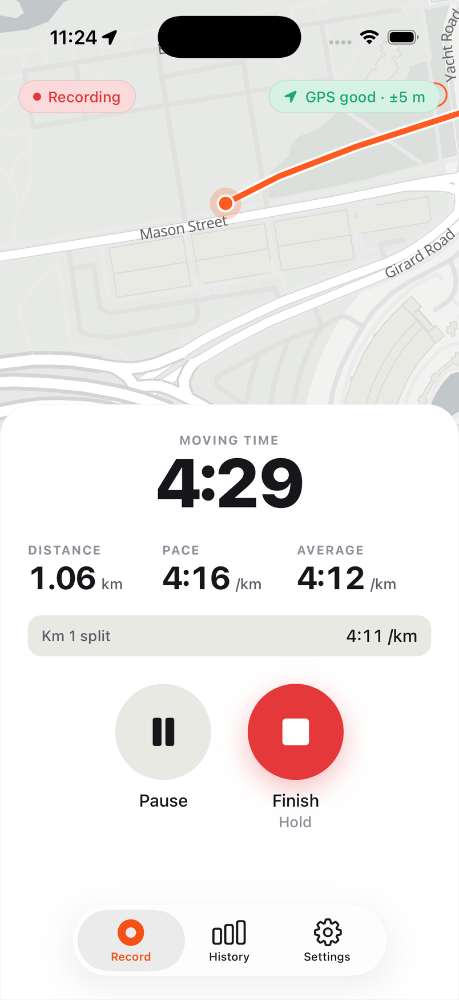
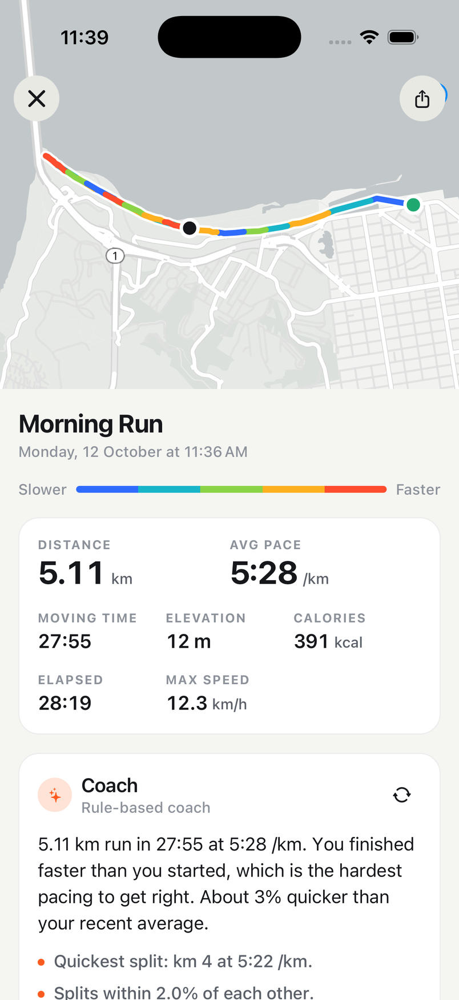
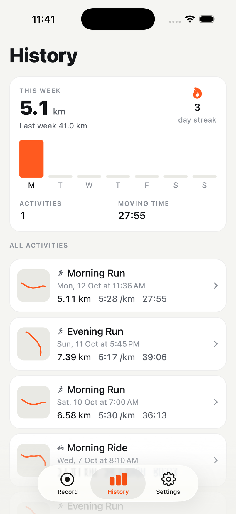
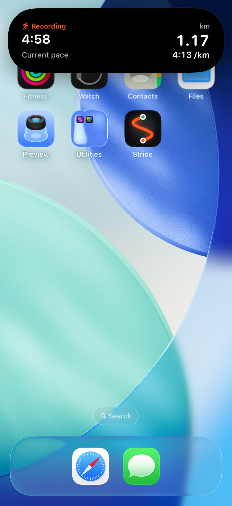
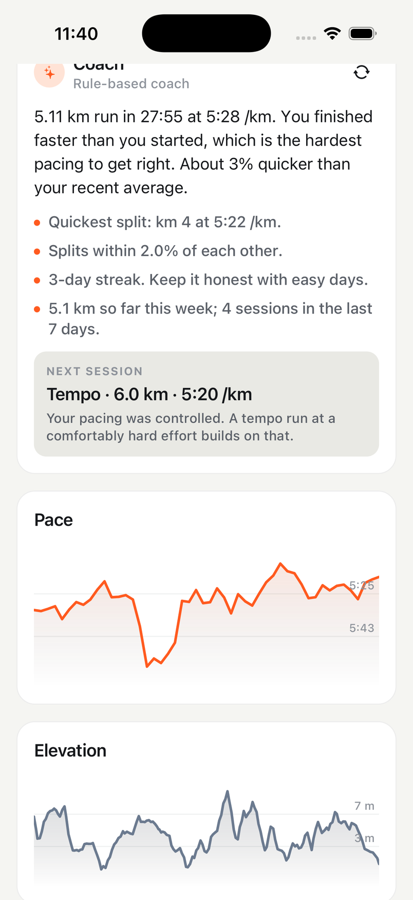
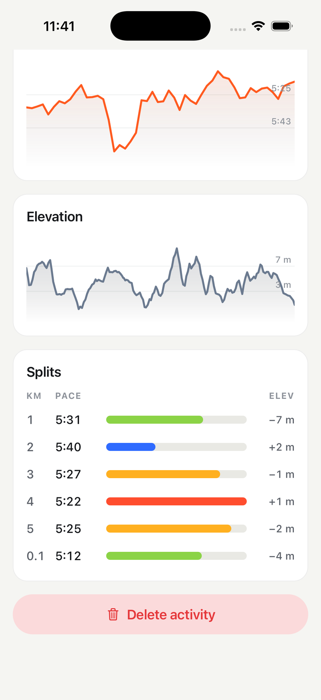
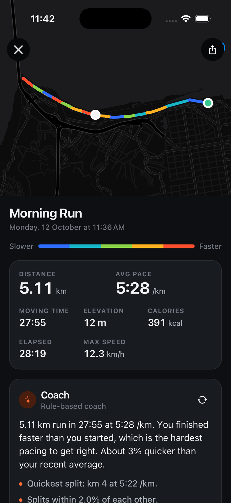
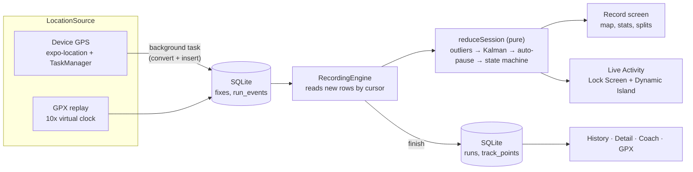
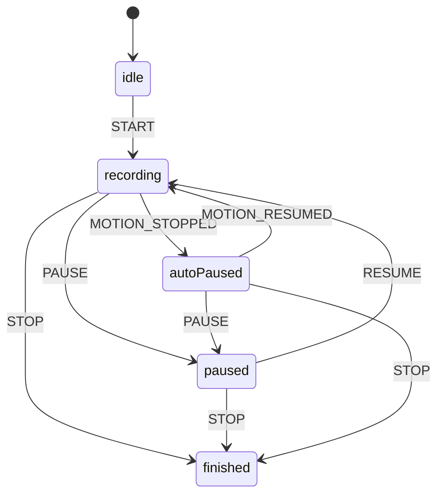

# Stride

**A run and ride tracker for iOS and Android that keeps recording with the phone locked: live route on the map, a Live Activity in the Dynamic Island, and a coach that reads your history.**

[](https://github.com/OwaisMunawar/stride/actions/workflows/ci.yml)
[](https://docs.expo.dev/versions/v57.0.0/)
[](https://reactnative.dev)
[](LICENSE)

<p align="center">
  
  
  
  
</p>

<p align="center">
  
  
  
  
</p>

<sub>Simulator captures (iPhone 17 Pro, iOS 26.5) with simulated GPS: routes were fed through `xcrun simctl location` or the bundled GPX replay. The runs in History are fictional demo data.</sub>

## Why

Background location is where most React Native tracking apps fall apart. The recording works on the desk, then the runner locks the phone and the line goes straight across the park, the clock keeps counting at every red light, or the app is killed and the run is gone.

Stride is built around that failure mode:

- **The background task is three lines of work.** It converts fixes and writes them to SQLite. Nothing else runs while the screen is off that could crash.
- **The recording is a pure fold over what was stored.** Commands (start, pause, resume, stop) and raw fixes go into SQLite; a pure reducer turns them into the live state. After a crash or reload the app replays the same rows and lands on the same state.
- **Every step of the filter is a small, tested function.** Outlier gate, Kalman filter, auto-pause, splits, elevation: each has property-based tests on synthetic tracks.

## Features

- **Record** runs and rides: start, pause, resume, hold to finish. Auto-pause at crossings with three sensitivities. GPS accuracy indicator. Split haptics.
- **Lock-screen safe**: iOS background location mode and an Android foreground service with a persistent notification. Two-step permission flow with a rationale screen.
- **Live map**: MapLibre with free OpenFreeMap tiles, following the runner.
- **Live Activity and Dynamic Island** (iOS): moving time ticking natively, distance, current pace, paused state.
- **History**: Skia route thumbnails drawn from a stored polyline (no tiles), this week's distance, a seven-day bar chart and the current streak.
- **Run detail**: route coloured by pace, splits table, Skia pace and elevation charts, calories, elevation gain.
- **Coach**: a post-run summary, highlights and a next-session suggestion with target distance and pace. Rule-based by default; Apple Foundation Models on device; or any OpenAI-compatible server.
- **GPX 1.1** export to the share sheet, and import through the same pipeline as a recording.
- **Units** (km/mi), weight for calorie estimates, privacy summary in Settings.
- **Demo mode**: ten fictional sessions and a "Simulate run" button that replays a bundled GPX at 10x through the real pipeline.

## Architecture





Feature-first layout (`src/features/{recording,tracking,history,coach,export,settings,demo}`), shared `src/core` (database, theme, UI primitives, units, errors), thin Expo Router routes in `src/app`, and one composition root that wires native modules to interfaces. The location source, the coach, the Live Activity and storage are all interfaces, so the whole recording pipeline runs in Jest on an in-memory database. Decisions and rejected alternatives are in [docs/ARCHITECTURE.md](docs/ARCHITECTURE.md).

## How tracking works

1. **Outlier gate.** A fix is dropped if its accuracy is worse than 35 m, its timestamp does not move forward, or reaching it would need more than 12 m/s on foot (30 m/s on a bike) after allowing for its own uncertainty. Three consecutive "impossible" fixes that agree with each other are a re-acquisition after a tunnel, not noise: the filter re-anchors and the route line breaks rather than drawing the jump.
2. **Kalman filter.** Constant-velocity model in local metres, with each fix weighted by its reported accuracy. Unlike the common constant-position filter, it does not trail a moving runner by several metres, so distance is not lost at every stop.
3. **Auto-pause.** When speed (the chip's Doppler speed, or displacement over ten seconds) stays under a threshold for a dwell time, the clock stops, back-dated to when you slowed. Resuming needs consecutive readings above a higher threshold, so one GPS jump cannot restart it. While auto-paused, drift adds no distance.
4. **Splits and pace.** Splits are cut at exact kilometre or mile boundaries, interpolating time and altitude inside the crossing segment, and timed on moving time only. Live pace is the last 30 seconds of the current segment; the chart uses 100 m buckets with a centred moving average.
5. **Elevation.** Altitude smoothed over about 30 seconds with a 4 m dead band, so GPS altitude noise on a flat loop does not invent climbing.
6. **Calories.** Running: about 1 kcal per kg per km (Margaria et al., 1963) plus resting metabolism. Riding: MET values by speed band from the Compendium of Physical Activities (Ainsworth et al., 2011). Labelled as estimates.

## Tech stack

| Area          | Choice                                                                                                                                   |
| ------------- | ---------------------------------------------------------------------------------------------------------------------------------------- |
| App           | Expo SDK 57, React Native 0.86, React 19.2, Expo Router (native tabs), React Compiler, TypeScript strict with `noUncheckedIndexedAccess` |
| Location      | `expo-location` background updates + `expo-task-manager`                                                                                 |
| Maps          | `@maplibre/maplibre-react-native` 11, OpenFreeMap vector tiles                                                                           |
| Live Activity | `expo-widgets` with `@expo/ui` SwiftUI components                                                                                        |
| Graphics      | `@shopify/react-native-skia` (charts, thumbnails), Reanimated 4                                                                          |
| Storage       | `expo-sqlite`, versioned migrations, repositories over a driver interface                                                                |
| Coach         | Local Expo module for Apple Foundation Models (Swift, `@Generable`), AI SDK v7 structured output, zod                                    |
| Lists         | `@legendapp/list`                                                                                                                        |
| Testing       | Jest (`jest-expo`), fast-check property tests, Testing Library, better-sqlite3, Maestro                                                  |
| CI            | GitHub Actions: format, lint, types, coverage gate, expo-doctor, iOS simulator build, Android debug build                                |

## Quick start

```sh
npm ci
cp .env.example .env.local      # sets EXPO_PUBLIC_DEMO=1
npx expo run:ios                # or: npx expo run:android
```

Background location and Live Activities need a development build; Expo Go cannot run them. In demo mode the Record tab shows **Simulate a 5 km run at 10x**, which replays a bundled GPX through the same pipeline as the GPS. To feed the real GPS path on an iOS simulator instead:

```sh
xcrun simctl location booted start --speed=3.2 37.8063,-122.4389 37.8040,-122.4588 37.8102,-122.4767
```

## Battery and permissions

- **Only while recording.** Location updates start with Start and stop with Finish. There is no geofencing, significant-change monitoring or background fetch.
- **One fix per second** at `BestForNavigation` accuracy with `activityType: fitness`. That is the cost of accurate splits; it is roughly what a sports watch app uses. `pausesUpdatesAutomatically` is off so iOS never decides on its own that the run is over.
- **Manual pause keeps the GPS on** (it does not record): restarting the receiver after a pause costs a cold fix and a wobbly first 100 m.
- **iOS** asks for "While Using" first, then "Always" with an explanation. With only "While Using", recording continues in the background with the blue indicator, and the app shows a banner suggesting "Always".
- **Android** shows a "Stride is recording" foreground-service notification for as long as a run is live. Some vendors kill background apps aggressively regardless; see [dontkillmyapp.com](https://dontkillmyapp.com).

## Privacy

Data stays on the device: runs, routes and settings live in a local SQLite database. No account, analytics, crash reporting or ads. What leaves the phone, exactly:

- **Map tiles** from OpenFreeMap, which reveal the map area being viewed, as with any online map.
- **Only if you select the Server coach** (and the app was built with an endpoint): the computed numbers for one run (distance, pace, split paces, weekly totals). Never coordinates.

ESLint bans `fetch` and friends everywhere except the server coach, so this list cannot grow by accident.

## Quality

- 175 tests, about 99% line coverage on domain, repositories, engine and coach code, gated at 90% in CI.
- Property-based tests for distance and splits on synthetic tracks, outlier rejection, auto-pause, the state machine, stored-state replay, GPX round-trip and unit conversions.
- Engine tests on in-memory SQLite, including a simulated app restart in the middle of a run.
- Component tests render real screens over the real service container. Maestro flows in [`.maestro/`](.maestro) drive a demo build end to end.
- Strict TypeScript, no `any`, typed errors with codes, ESLint (`eslint-config-expo`) and Prettier.

## Roadmap

- Android home screen widget with this week's distance.
- Heart rate from HealthKit and Health Connect, and writing workouts back to both.
- Audio cues for splits.
- Route planning and following a saved route.
- Segments: matching repeated stretches across runs to compare efforts.

## License

[MIT](LICENSE). Map data © [OpenStreetMap](https://www.openstreetmap.org/copyright) contributors, tiles by [OpenFreeMap](https://openfreemap.org) using the [OpenMapTiles](https://openmaptiles.org) schema.

---

Built by [Owais Munawwar](https://github.com/OwaisMunawar). I'm available for React Native, AI and iOS work on [Upwork](https://www.upwork.com/freelancers/owaism11).
