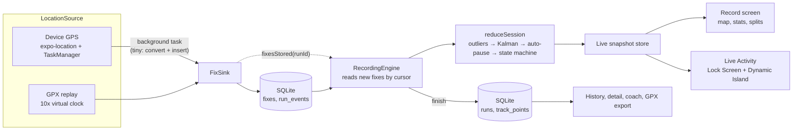
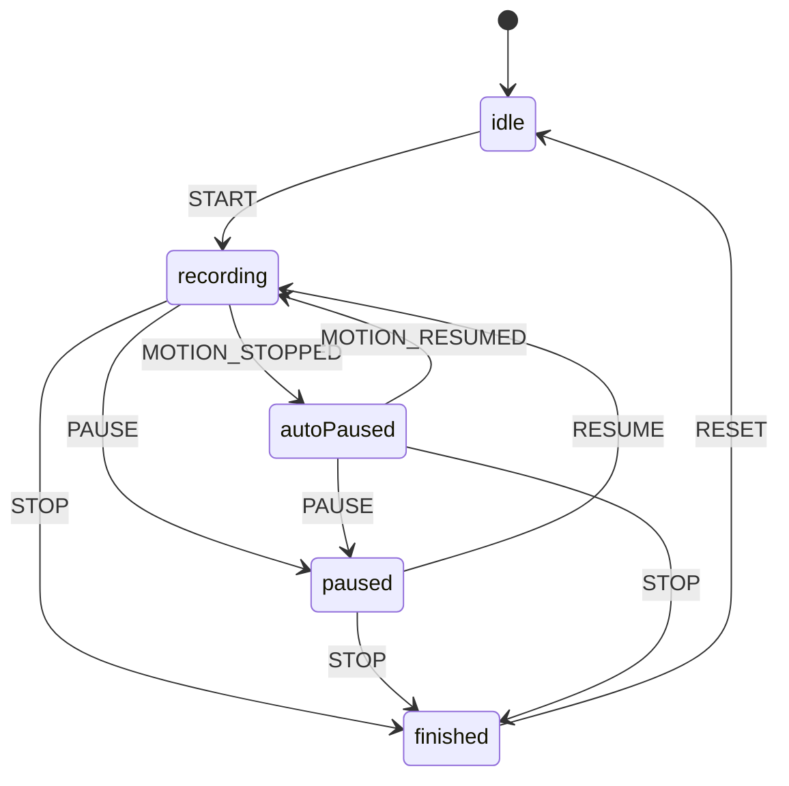

# Architecture

Stride is a feature-first Expo app. Domain logic (filtering, the recording state machine, splits, the coach's analysis) is pure TypeScript with no React or native imports, enforced by ESLint, so it runs the same in Jest, in the UI and inside the background location task.

```
src/
  app/                 Expo Router routes. Each file only picks a screen.
  composition/         The one place that knows about native modules: builds the service container,
                       opens the database, registers the background task.
  core/                db (driver, migrations), theme, ui primitives, units, errors, charts geometry.
  features/
    tracking/          Geo maths, Kalman filter, outlier gate, auto-pause, splits, pace, elevation,
                       calories, the route map.
    recording/         State machine, session reducer, location sources, background task,
                       recording engine, Live Activity, record screen.
    history/           Run repository, weekly totals and streak, thumbnails, history and detail screens.
    coach/             Coach interface, facts, rule-based coach, on-device and server coaches, cache.
    export/            GPX 1.1 writer and parser, import and export use cases.
    settings/          Settings schema, repository and screen.
    demo/              Route generator, seed plan and the bundled GPX replay.
modules/stride-coach/  Local Expo module: Apple Foundation Models with guided generation.
```

## Data flow



The engine never receives a fix directly. Every source writes into SQLite through the same sink, and the engine reads back whatever is new. This single path is the whole crash-recovery story: after the app is killed or Metro reloads, `engine.restore()` replays the stored commands and fixes through the same pure reducer and arrives at the same state.

## Recording state machine



Events that do not apply in the current state are ignored, never thrown: a double tap on Pause, or a motion event landing just after a manual pause, must not crash a run. Moving time is the sum of the intervals spent in `recording`; an auto-pause is back-dated to when the slowdown began, so the dwell time before the detector decides is not counted.

## Architecture decisions

### ADR-001: MapLibre over Mapbox and react-native-maps

**Decision:** `@maplibre/maplibre-react-native` 11 with OpenFreeMap vector tiles.

- **react-native-maps** renders Apple Maps on iOS and Google Maps on Android. Two map engines means two visual languages, Google needs an API key and billing account, and per-segment coloured polylines are slow with thousands of vertices.
- **Mapbox** (`@rnmapbox/maps`) is excellent but needs a token, has a usage-based price, and the SDK download needs a secret token at build time. That is friction for anyone cloning the repo.
- **MapLibre** is the open-source fork of Mapbox GL: one GPU renderer on both platforms, data-driven styling (the pace colours are one `match` expression on a GeoJSON source), and no keys. v11 has a modern declarative API (`Map`, `Camera`, `GeoJSONSource`, `Layer`).

Tiles come from [OpenFreeMap](https://openfreemap.org): free, no key, no tracking, OpenMapTiles schema from OpenStreetMap data. Attribution (OpenFreeMap, OpenMapTiles, OpenStreetMap contributors) is shown by the map's info button and in Settings.

### ADR-002: expo-location over react-native-background-geolocation

**Decision:** `expo-location` background updates through `expo-task-manager`.

- **react-native-background-geolocation** (Transistor Software) is the most battle-tested option, with motion-activity-based battery management. It is also a paid licence for Android release builds, and its own SQLite queue, HTTP sync layer and filter would duplicate (and hide) exactly the parts this project wants to own and test.
- **expo-location** gives the primitives that matter: `startLocationUpdatesAsync` with `BestForNavigation` accuracy, `activityType: fitness`, `pausesUpdatesAutomatically: false`, the blue background indicator on iOS and a foreground service with a persistent notification on Android. It ships with the SDK, so upgrades are coordinated.

The cost is that battery management is ours. Stride keeps it simple (see the README): one fix per second while recording, nothing at all otherwise.

### ADR-003: expo-sqlite, one serialised connection

**Decision:** `expo-sqlite` behind a small `SqlDriver` interface, versioned migrations in `PRAGMA user_version`.

- **op-sqlite** is faster and was the right call in projects that need vector search or bulk reads. Here the hot path is one small insert per second; raw speed is irrelevant, and expo-sqlite is SDK-pinned, needs no extra config, and works the same in the background task.
- **MMKV / AsyncStorage** cannot query or index, and a 7,000-point track would be one giant JSON blob rewritten every second.

The background task and the UI share one connection, so every statement goes through a single promise queue. Without it, a fix insert from the task could interleave with the "finish run" transaction and be rolled back with it. In tests, `better-sqlite3` runs the same schema and queries in memory.

A partial unique index (`ON runs (status) WHERE status = 'active'`) makes "only one recording at a time" a database guarantee, not a UI convention.

### ADR-004: Filtering: outlier gate, constant-velocity Kalman, dead-band elevation

**Decision:** a pipeline of small pure steps, each with its own tests:

1. **Outlier gate.** Drop fixes with reported accuracy worse than 35 m, timestamps that do not move forward, and positions implying more than 12 m/s running (30 m/s riding) after subtracting the fix's own uncertainty. Three consecutive "impossible" fixes that agree with each other mean the receiver re-acquired after a tunnel: the filter re-anchors and the line breaks instead of being rejected forever.
2. **Kalman filter.** Constant-velocity model per axis in local metres, measurement noise from each fix's accuracy, white-acceleration process noise (1.5 m/s² running, 2.5 riding). The common constant-position filter trails a moving athlete by ~8 m at all times, which undercounts distance at every pause and drags the live marker; modelling velocity removes that lag on straight stretches.
3. **Auto-pause.** Speed (device Doppler speed when present, otherwise displacement over a 10 s window) below a threshold for a dwell time stops the clock, back-dated to when the slowdown began. Resuming needs two or three consecutive readings above a higher threshold (hysteresis), so a single GPS jump cannot restart the clock.
4. **Elevation.** GPS altitude is the noisiest axis. A centred moving average over about 30 s, then a 4 m dead band: climbing only counts once the smoothed altitude moves 4 m from the last anchor.

**Rejected:** map-matching (needs a routing graph and a server), Douglas-Peucker before measuring (shortens every curve), and a particle filter (accurate, but heavy and hard to test deterministically).

### ADR-005: The coach behind one interface, facts computed in code

**Decision:** `Coach { analyze(context): Promise<RunInsight> }` with three implementations, all producing the same zod-validated `RunInsight` (summary, highlights, next-session kind, distance, target pace, rationale).

- **Rule-based (default, demo).** Deterministic text from computed facts and a next-run plan: recover after a hard or longest-in-six-weeks effort, hold volume after a >10% weekly jump, tempo after controlled pacing, long run in a light week, otherwise easy. Works offline everywhere, stable in tests.
- **On device.** Apple Foundation Models through a local Expo module (`modules/stride-coach`). `@Generable` structs give typed output with no JSON repair; `#available(iOS 26.0, *)` and a weak-linked framework keep the module loadable on iOS 17-25. Nothing leaves the phone.
- **Server.** AI SDK v7 `generateText` with `Output.object({ schema })` against any OpenAI-compatible endpoint configured at build time (a proxy that holds the key, or a local model server). The app never ships a provider key.

The models never see GPS. They receive the computed facts (distance, pace, split trend, weekly totals) and the rule-based plan, and are asked to write about them. Their numbers are then clamped to the plan's neighbourhood (`guardInsight`), because "42 km tomorrow at 3:00/km" is the kind of confident nonsense a small model occasionally produces. Any failure falls back to the rule-based coach, and the card says so.

### ADR-006: The Live Activity is fed by the engine, not the task

The background task only stores fixes. Pushing Live Activity updates from the task would mean the task needs units, formatting and throttling: everything that should stay out of it. Instead the engine, which runs in the same JS runtime while iOS keeps the app alive for location, updates the activity at most every 5 s plus on every status change (ActivityKit budgets updates). Between updates the clock ticks natively: the activity gets `timerStart` and SwiftUI's `Text(timerInterval:)` counts on its own, with `pauseTime` freezing it while paused.

### ADR-007: Privacy as a lint rule

`fetch`, `XMLHttpRequest`, `WebSocket` and `EventSource` are banned by ESLint everywhere except the server coach, and the AI SDK may only be imported there. Map tiles are fetched by the native map view. What leaves the phone is therefore exactly: tile requests, and (only with the server coach selected) the computed facts for one run.

## Testing strategy

- **Property tests** (fast-check) for the parts with infinite input space: haversine axioms, distance on synthetic constant-speed tracks, splits summing to moving time for any speed and unit, outlier gate never rejecting a plausible track, auto-pause hysteresis, the state machine's invariants, replaying stored inputs equalling incremental folding, GPX round-trip, unit conversions.
- **Repository and engine tests** on in-memory SQLite with real migrations, including a simulated process restart.
- **Component tests** render real screens over the real service container with fake platform edges.
- **Maestro flows** in `.maestro/` drive a demo build: simulate a run, pause, finish, read the coach; browse history; switch units.

Coverage is gated at 90% lines on domain, repositories, engine and coach code in CI.
